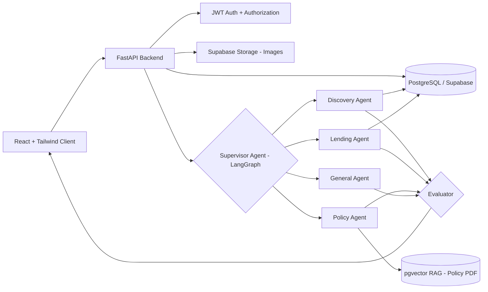
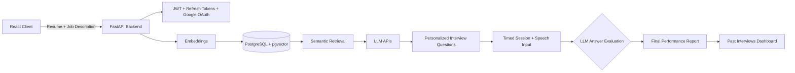
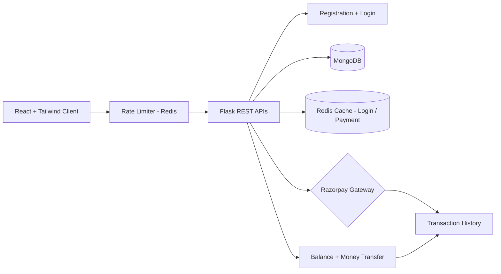
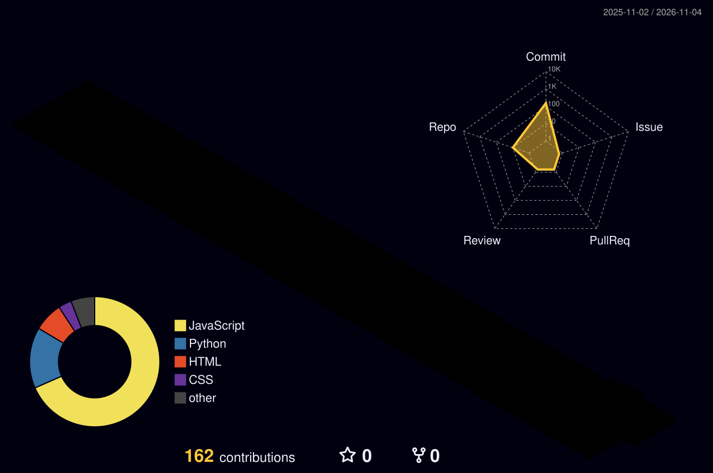

<!-- Profile README: Shivamsharma890 -->

<div align="center">


<a href="https://github.com/Shivamsharma890">
  
</a>

<br/>

[](https://github.com/Shivamsharma890)
[](mailto:ss7614103@gmail.com)
[](https://www.linkedin.com/in/shivam-sharma-6496712b6)
[](https://github.com/Shivamsharma890)

<br/>

📍 Gwalior, Madhya Pradesh &nbsp;·&nbsp; 🎯 Open to Internships &nbsp;·&nbsp; ⚡ Replies within 24h


</div>

---

## 👨‍💻 About Me

<table align="center" width="100%">
  <tr>
    <td width="50%" valign="top">

**🎓 Education**<br/>
B.Tech in Computer Science & Engineering<br/>
Madhav Institute of Technology & Science, Gwalior<br/>
<sub>Sep 2024 – Jul 2028</sub>

<br/>

**💼 Experience**<br/>
Web Developer Intern · ApexPlanet Software<br/>
<sub>Jun 2025 – Aug 2025</sub>

</td>
    <td width="50%" valign="top">

**🧭 Current Focus**<br/>
🤖 Multi-agent AI systems with LangGraph<br/>
📚 Production-grade RAG pipelines<br/>
🏗️ System design & scalable FastAPI backends<br/>
🧩 Data Structures & Algorithms

<br/>

**🏁 Milestone**<br/>
✅ Completed Striver SDE Sheet 45-Day Challenge

</td>
  </tr>
</table>

---

## 🏆 Highlights

<table align="center">
  <tr>
    <td align="center" width="200">
      🥇<br/><b>Striver SDE Sheet</b><br/><sub>45-Day Challenge · Completed</sub>
    </td>
    <td align="center" width="200">
      🤖<br/><b>Multi-Agent AI</b><br/><sub>LangGraph + LangChain</sub>
    </td>
    <td align="center" width="200">
      📚<br/><b>RAG Pipelines</b><br/><sub>pgvector + Embeddings</sub>
    </td>
    <td align="center" width="200">
      🚀<br/><b>3 Full-Stack Projects</b><br/><sub>AI · Fintech · Marketplace</sub>
    </td>
  </tr>
</table>

---

## 💻 Tech Arsenal

<table align="center">
  <tr>
    <td><b>Languages</b></td>
    <td></td>
  </tr>
  <tr>
    <td><b>Frontend</b></td>
    <td>
      
      
    </td>
  </tr>
  <tr>
    <td><b>Backend & Auth</b></td>
    <td>
      
      
      
      
      <br/><br/>
      <kbd>&nbsp;REST APIs&nbsp;</kbd>
    </td>
  </tr>
  <tr>
    <td><b>Agentic / GenAI</b></td>
    <td>
      
      
      <br/><br/>
      <kbd>&nbsp;LangGraph&nbsp;</kbd> &nbsp;<kbd>&nbsp;Multi-Agent Systems&nbsp;</kbd> &nbsp;<kbd>&nbsp;RAG&nbsp;</kbd> &nbsp;<kbd>&nbsp;LLM Tool Calling&nbsp;</kbd> &nbsp;<kbd>&nbsp;Groq API&nbsp;</kbd>
    </td>
  </tr>
  <tr>
    <td><b>Databases</b></td>
    <td>
      
      <br/><br/>
      <kbd>&nbsp;pgvector&nbsp;</kbd>
    </td>
  </tr>
  <tr>
    <td><b>Tools & Cloud</b></td>
    <td>
      
      
    </td>
  </tr>
</table>

---

## 🚀 Featured Builds — Architecture Deep-Dive

<details open>
<summary><b>🎓 CampusLoop AI</b> — multi-agent campus borrowing marketplace</summary>
<br/>



```yaml
stack: [React.js, Tailwind CSS, FastAPI, LangGraph, LangChain, PostgreSQL, pgvector, Supabase]
repo:  github.com/Shivamsharma890
notes:
  - "Supervisor agent routes queries to Discovery, Lending, Policy and General agents"
  - "Evaluator step checks every agent response before it reaches the user"
  - "RAG pipeline: PDF loading -> chunking -> Sentence Transformers -> pgvector search"
  - "Borrow-request approval/rejection with unread-notification tracking"
```

</details>

<details>
<summary><b>🎤 Interxora.ai</b> — AI interview practice & performance platform</summary>
<br/>



```yaml
stack: [React.js, FastAPI, LLM APIs, RAG, Embeddings, PostgreSQL, pgvector, JWT, Google OAuth]
repo:  github.com/Shivamsharma890
notes:
  - "Generates technical + behavioral interviews from resume and target job description"
  - "Timed sessions with speech input and LLM-based answer evaluation"
  - "Enumeration-safe forgot-password flow with Gmail SMTP"
```

</details>

<details>
<summary><b>💸 Money Fintrack</b> — full-stack finance management app</summary>
<br/>



```yaml
stack: [React.js, Tailwind CSS, Flask, MongoDB, Redis, Razorpay]
repo:  github.com/Shivamsharma890
notes:
  - "Balance management, money transfer, transaction history, profile management"
  - "Razorpay payment gateway integrated and tested with real payments"
  - "Redis used for login/payment caching with rate limiting"
```

</details>

---

## 📊 GitHub Analytics

<div align="center">


<br/>


<br/><br/>



<br/><br/>


</div>

---

<div align="center">

<i>Always happy to talk AI, backend architecture, hackathons, or internships — reach out anytime 🚀</i>


</div>
